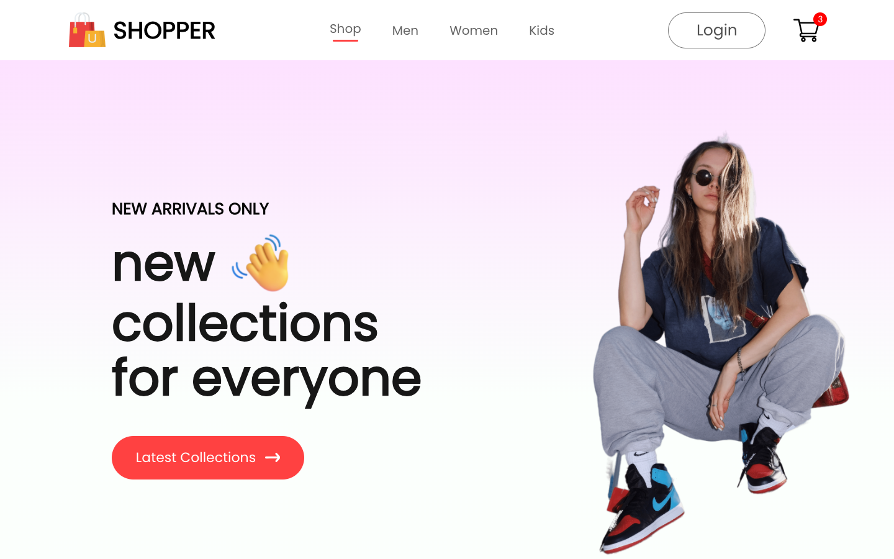
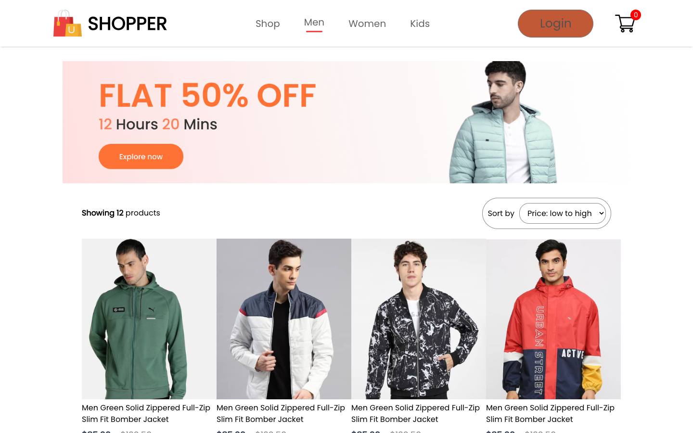
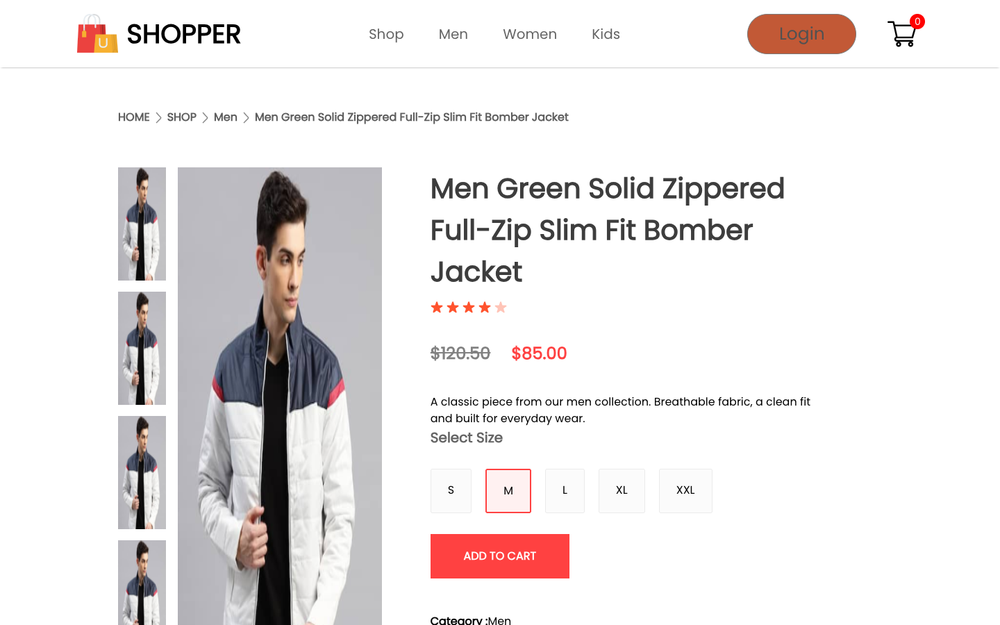
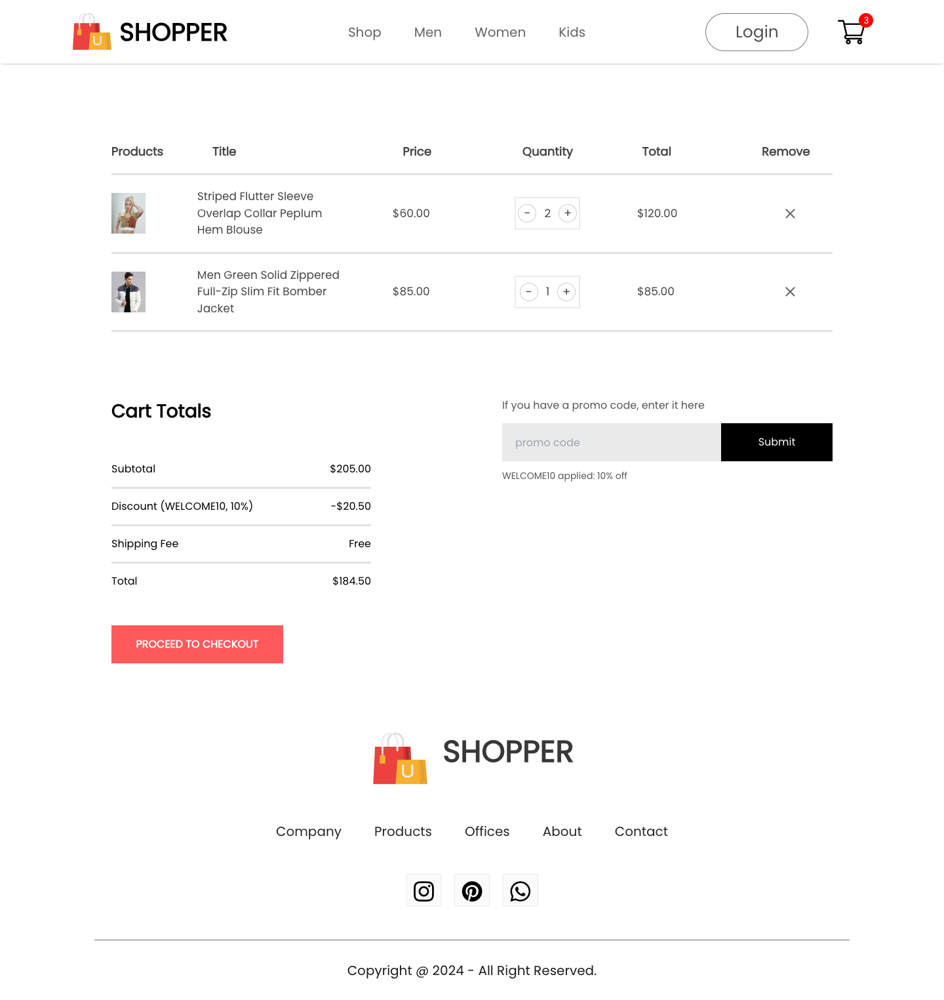
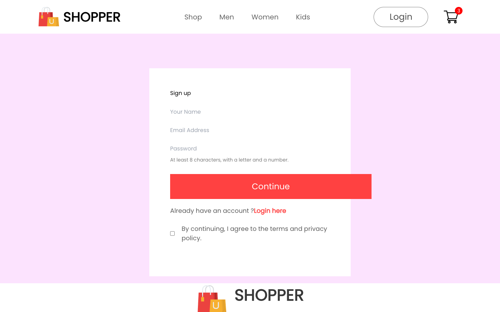
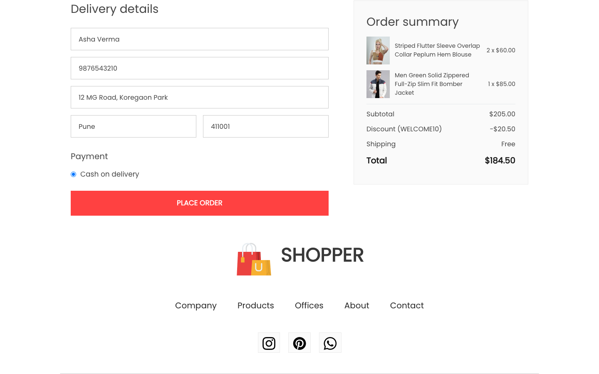
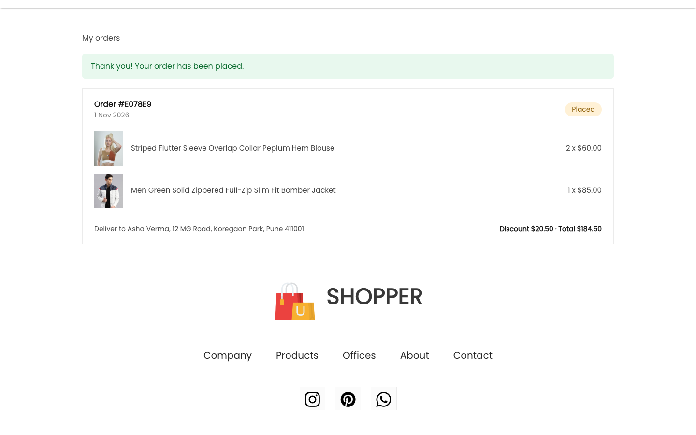
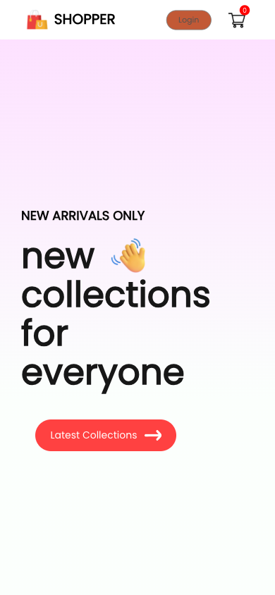

# Shopper

A full-stack online clothing store. Visitors browse men, women and kids collections, build a cart, sign up, apply a promo code and place an order. The React frontend talks to a Node, Express and MongoDB API.

**Stack:** React 18 · React Router · Node.js · Express · MongoDB (Mongoose) · JWT

## Screenshots

| Home | Category with sorting |
|---|---|
|  |  |

| Product page | Cart with a promo code |
|---|---|
|  |  |

| Sign up and login | Checkout |
|---|---|
|  |  |

| My orders | Mobile |
|---|---|
|  |  |

## Features

- 36 products in men, women and kids categories, with popular and new-collection sections
- Sort a category by price, open a product, choose a size, see related products
- A cart for visitors (kept in the browser) that is merged into the saved cart when they log in
- Sign up and login with hashed passwords and JWT sessions
- Promo codes (`WELCOME10` for 10% off, `SHOPPER20` for 20% off)
- Checkout with a delivery address and cash on delivery. Prices and totals are always calculated on the server
- Order history for each customer
- Newsletter signup
- Admin API to add, edit and delete products

## Project structure

```
E-commerce-website/
├── backend/                 Express API
│   ├── config/db.js         MongoDB connection
│   ├── data/products.json   the 36 products used to seed the database
│   ├── middleware/auth.js   login check and admin check
│   ├── models/              Product, User, Order, Subscriber
│   ├── routes/              products, auth, cart, orders, newsletter
│   ├── scripts/
│   │   ├── seed.js          loads the products (and an admin account)
│   │   └── dev-memory.js    runs everything on a throwaway in-memory database
│   ├── test/api.test.js     API tests
│   ├── utils/cart.js        cart totals and promo codes
│   ├── app.js               Express app (CORS, rate limits, routes)
│   ├── index.js             starts the server
│   └── .env.example
├── frontend/                React app (Create React App)
│   ├── public/
│   ├── src/
│   │   ├── __tests__/       frontend tests
│   │   ├── components/      Navbar, Hero, Popular, NewCollections, Itemss (product card),
│   │   │                    ProductDisplay, RelatedProducts, CartItems, Footer, NewsLetter, ...
│   │   ├── context/         ShopContext: products, cart, login state
│   │   ├── pages/           Shop, ShopCategory, Product, Cart, Checkout, Orders, LoginSignup
│   │   ├── services/api.js  fetch wrapper that adds the login token
│   │   ├── styles/          extra styles
│   │   └── utils/           money formatting, product image lookup
│   ├── vercel.json          sends every path to the app so links work after a refresh
│   └── .env.example
├── docs/screenshots/        images used in this README
├── render.yaml              Render deployment for the API
└── .gitignore
```

## Getting started

Requires Node.js 20.19 or newer.

```bash
# 1. backend (a throwaway database with the products already loaded)
cd backend
npm install
npm run dev:memory          # API on http://localhost:4000
                            # admin login: admin@shopper.dev / Admin1234

# 2. frontend, in a second terminal
cd frontend
npm install
npm start                   # http://localhost:3000
```

To use your own MongoDB instead, copy `backend/.env.example` to `backend/.env`, fill it in, then:

```bash
cd backend
npm run seed                # add ADMIN_EMAIL and ADMIN_PASSWORD to also create an admin
npm run dev
```

### Environment variables

Backend (`backend/.env`):

| Variable | Purpose |
|---|---|
| `MONGODB_URL` | MongoDB connection string |
| `JWT_SECRET` | Secret used to sign login tokens |
| `CLIENT_URL` | Allowed frontend origin(s), comma separated. Leave out for local development |
| `PORT` | Defaults to `4000` |

Frontend (`frontend/.env`):

| Variable | Purpose |
|---|---|
| `REACT_APP_API_URL` | Backend URL, for example `https://shopper-api.onrender.com`. Defaults to `http://localhost:4000` |

## API

All routes are under `/api`. Routes marked with a lock need `Authorization: Bearer <token>`.

| Area | Routes |
|---|---|
| Products | `GET /products` (`category`, `search`, `sort`, `page`, `limit`), `/products/new`, `/products/popular`, `/products/:id`, `/products/:id/related` |
| Accounts | `POST /auth/signup`, `POST /auth/login`, `GET /auth/me` (lock) |
| Cart | `GET /cart` (lock), `POST /cart/add`, `/cart/remove`, `/cart/merge` (lock), `DELETE /cart/items/:id`, `DELETE /cart` (lock), `POST /cart/promo` |
| Orders | `POST /orders`, `GET /orders`, `GET /orders/:id` (all lock) |
| Newsletter | `POST /newsletter` |
| Admin | `POST /products`, `PUT /products/:id`, `DELETE /products/:id` (admin only) |

`GET /health` reports whether the database is connected.

## Tests

```bash
cd backend && npm test      # 13 API tests on an in-memory database
cd frontend && CI=true npm test -- --watchAll=false    # 8 component tests
```

## Deployment

**API on Render:** create a web service from this repository (it reads `render.yaml`). Set `MONGODB_URL` and `CLIENT_URL` (the exact frontend URL). Then, once, from your computer:

```bash
cd backend
MONGODB_URL='<your connection string>' ADMIN_EMAIL='you@example.com' ADMIN_PASSWORD='<strong password>' npm run seed
```

**Frontend on Vercel:** import the repository, set the Root Directory to `frontend`, and add `REACT_APP_API_URL` pointing at the Render service.

Render's free plan sleeps when idle, so the first request after a break can take up to a minute.

## Limitations

- Payment is cash on delivery only. There is no payment gateway
- Promo codes are defined in the code, not in the database
- Products can be managed through the admin API, but there is no admin screen yet
- Product images are bundled with the frontend
